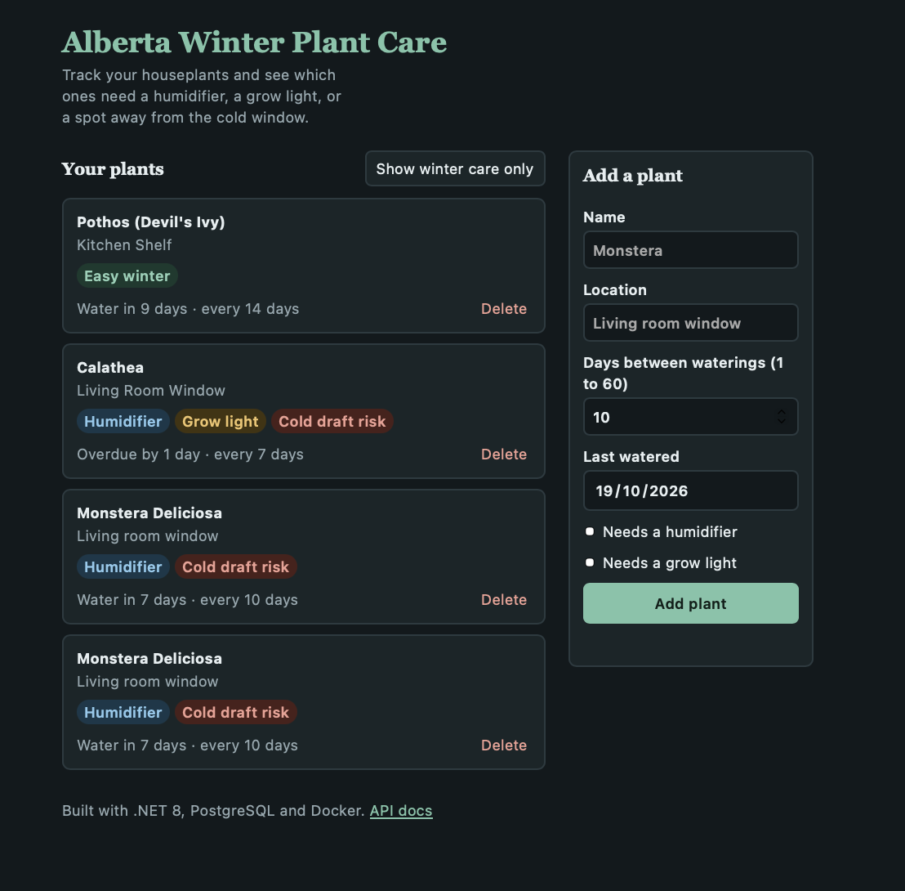

# 🪴 Alberta Winter Plant Care API




A RESTful Web API for tracking indoor houseplants and generating care alerts for Alberta's harsh winters: extremely dry air, short daylight hours, and cold drafts near windows.

Built with **.NET 8**, **Entity Framework Core**, **PostgreSQL**, and **Docker**.


## Why this project?

Indoor humidity in Alberta homes can drop below 20% in winter, and many houseplants struggle with it. This API helps answer: *which of my plants need a humidifier, a grow light, or to be moved away from a cold window?*

## Features

- **Full CRUD** for the plant inventory (create, read, update, delete).
- **Winter care alerts**: `GET /api/Plants/alberta-winter-care` returns plants that require a humidifier or a grow light.
- **Cold draft detection**: a computed property (`isDraftRisk`) flags plants located near windows or drafts.
- **Input validation**: requests are validated with DTOs and return standard `ProblemDetails` (RFC 9110) errors.
- **Persistent storage** in PostgreSQL using EF Core migrations, with seed data on first run.
- **Interactive docs** with Swagger UI.
- **Simple web UI** to view, add and delete plants, and filter winter care alerts.

## Tech Stack

| Area | Technology |
|------|------------|
| Framework | .NET 8 Web API (C#) |
| ORM | Entity Framework Core 8 + Npgsql |
| Database | PostgreSQL 16 |
| Containers | Docker & Docker Compose |
| Docs | Swagger (Swashbuckle) |
| Architecture | Controller-Repository pattern with dependency injection |

## Getting Started

**Requirements:** [Docker Desktop](https://www.docker.com/products/docker-desktop/)

```bash
git clone https://github.com/RossyBlue/alberta-plant-care-api.git
cd alberta-plant-care-api 
docker compose up --build
```
cd PlantInventoryApi

Then open:

- **http://localhost:8080** for the web UI
- **http://localhost:8080/swagger** for the Swagger API docs

On first run the app applies the database migrations and seeds two sample plants (Pothos and Calathea). Data is stored in a Docker volume, so it survives `docker compose down`. Use `docker compose down -v` to wipe it and start fresh.

## Running Tests

```bash
dotnet test PlantInventoryApi.Tests
```

Tests cover the domain logic, DTO validation, the repository (EF Core InMemory) and the controller (Moq).

### Running without Docker for the API

```bash
docker compose up postgres-db   # start only the database
dotnet run                      # requires the .NET 8 SDK
```

The connection string for local runs is in `appsettings.Development.json`.

## API Endpoints

| Method | Endpoint | Description | Success |
|--------|----------|-------------|---------|
| GET | `/api/Plants` | List all plants | 200 |
| GET | `/api/Plants/{id}` | Get a plant by ID | 200 / 404 |
| GET | `/api/Plants/alberta-winter-care` | Plants that need a humidifier or grow light | 200 |
| POST | `/api/Plants` | Add a new plant | 201 / 400 |
| PUT | `/api/Plants/{id}` | Update an existing plant | 204 / 400 / 404 |
| DELETE | `/api/Plants/{id}` | Delete a plant | 204 / 404 |

### Validation rules

| Field | Rule |
|-------|------|
| `name` | Required, 2 to 100 characters |
| `locationInHouse` | Required, 2 to 200 characters |
| `winterWateringDaysInterval` | Between 1 and 60 |

### Example request

```bash
curl -X POST http://localhost:8080/api/Plants \
  -H "Content-Type: application/json" \
  -d '{
    "name": "Monstera Deliciosa",
    "locationInHouse": "Living room window",
    "requiresHumidifier": true,
    "needsGrowLight": false,
    "winterWateringDaysInterval": 10,
    "lastWatered": "2026-10-15T12:00:00Z"
  }'
```

### Example response (`201 Created`)

```json
{
  "id": 3,
  "name": "Monstera Deliciosa",
  "locationInHouse": "Living room window",
  "requiresHumidifier": true,
  "needsGrowLight": false,
  "winterWateringDaysInterval": 10,
  "lastWatered": "2026-10-15T12:00:00Z",
  "isDraftRisk": true
}
```

### Example validation error (`400 Bad Request`)

```json
{
  "type": "https://tools.ietf.org/html/rfc9110#section-15.5.1",
  "title": "One or more validation errors occurred.",
  "status": 400,
  "errors": {
    "Name": ["The Name field is required."]
  }
}
```

## Project Structure

```
├── Controllers/     # HTTP endpoints
├── Data/            # DbContext and database seeder
├── Migrations/      # EF Core migrations
├── Models/          # Plant entity and request DTO
├── Services/        # Repository interface and implementation
├── Dockerfile
└── docker-compose.yml
wwwroot/ # Static web UI.
```

## Design Decisions

- **Controller-Repository pattern** keeps HTTP logic separate from data access, which makes the code easier to test and maintain.
- **Dependency injection with an interface** (`IPlantRepository`) so the data layer can be swapped or mocked in tests.
- **DTOs for input** so the API validates what comes in and never exposes or accepts internal fields like `id` or `isDraftRisk`.
- **EF Core migrations** applied on startup, so `docker compose up` is all it takes to get a working environment.
- **Healthcheck in Docker Compose** so the API only starts once PostgreSQL is ready.

## Roadmap

- [x] Full CRUD (`PUT` and `DELETE`)
- [x] Input validation and standard error responses
- [x] PostgreSQL persistence with EF Core and migrations
- [x] Unit and integration tests (xUnit)
- [x] GitHub Actions CI
- [ ] Document response codes with `[ProducesResponseType]`
- [x] Simple web UI
- [ ] Real outdoor temperature alerts via Environment Canada
- [ ] Public deployment

## Author

**Rossy** · [GitHub](https://github.com/RossyBlue)